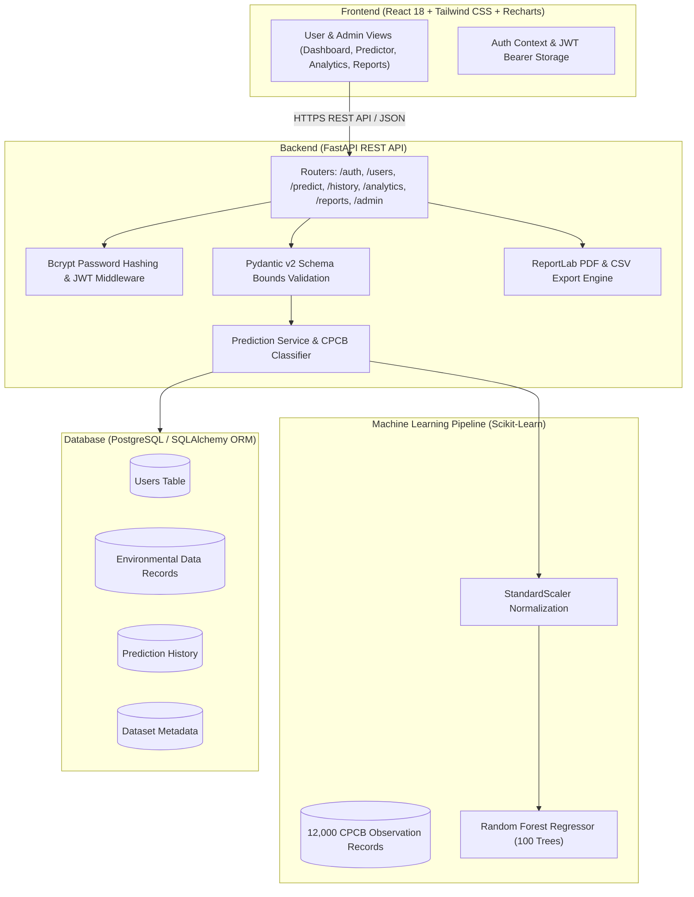

# AirGuard — Intelligent Air Quality Prediction System
### Complete Environmental Intelligence SaaS Platform

[](https://www.python.org/)
[](https://fastapi.tiangolo.com/)
[](https://reactjs.org/)
[](https://www.postgresql.org/)
[](https://scikit-learn.org/)
[](https://tailwindcss.com/)
[](https://docs.pytest.org/)

**AirGuard** is an end-to-end environmental intelligence SaaS web application built according to the **Software Engineering Laboratory** curriculum specifications. It transforms 8 atmospheric and meteorological parameters into real-time **Air Quality Index (AQI)** predictions, assigns standardized CPCB health categories, and provides interactive visualizations, downloadable PDF/CSV audit reports, and a dedicated administrator suite.

---

## 🌟 Key Capabilities & Features

### 1. Public Website
- **Landing Page**: Modern hero section, real-time CPCB category spectrum, 8-parameter breakdown, interactive architecture workflow.
- **About AirGuard**: Academic foundation, Software Engineering experiment reports, and technical methodology.
- **Features Page**: Commercial-grade architectural capabilities, real-time inference, and multi-tenant security overview.
- **Authentication**: JWT-based login and registration with 1-click Demo Fill buttons for both standard users and administrators.

### 2. User Application
- **User Dashboard**: Overview displaying latest AQI result with animated gauge, 8 parameter summary cards, chronological AQI trend chart, pollutant concentration comparison bar chart, and recent prediction log.
- **AQI Predictor**: 8-parameter input form (PM2.5, PM10, NO₂, SO₂, CO, O₃, Temperature, Humidity) with 4 quick environmental preset scenarios, real-time client-side validation, instant ML inference, and tailored health advisories.
- **Prediction History**: Filterable, searchable, and paginated history table with parameter detail modals and record deletion.
- **Analytics & Trends**: Multi-chart analytics dashboard featuring AQI progression lines, pollutant averages, category donut breakdown, and meteorological impact insights.
- **Reports Center**: 1-click export of official, printable vector PDF audit reports (built with ReportLab) and raw CSV spreadsheets.
- **Account Settings**: Profile updates, password management, and account metadata.

### 3. Administrator Application
- **Admin Dashboard**: System-wide statistics (total users, total predictions, active model status, R² accuracy score, category distribution).
- **User Management**: Administrative control to activate/deactivate accounts and promote/demote administrator privileges.
- **Dataset Management**: CPCB baseline dataset metadata viewer with 12,000 verified records and interactive data grid.
- **ML Model Management**: Real-time retraining pipeline trigger across all 4 candidate models with automated artifact updating.
- **Model Evaluation**: Benchmark comparison table and charts across Linear Regression, Decision Tree, Random Forest, and SVR evaluating MAE, MSE, RMSE, and R² scores.
- **Prediction Monitoring**: Live system-wide audit stream of all user prediction events.
- **System Reports & Audits**: Component uptime metrics and audit logs.
- **Admin Settings**: Runtime performance controls, rate limits, and threshold configurations.

---

## 🧪 Machine Learning Evaluation Results

AirGuard evaluates 4 candidate regression algorithms on a 12,000-record CPCB dataset using an 80/20 train-test split:

| Model | MAE | MSE | RMSE | $R^2$ Score | Selection |
| :--- | :---: | :---: | :---: | :---: | :---: |
| **Linear Regression** | 20.873 | 820.616 | 28.646 | 0.9067 | Baseline |
| **Decision Tree Regression** | 1.654 | 10.766 | 3.281 | 0.9988 | Candidate |
| **Random Forest Regression** | **0.697** | **3.669** | **1.915** | **0.9996** | **WINNER (Deployed)** |
| **Support Vector Regression (SVR)** | 6.609 | 123.965 | 11.134 | 0.9859 | Candidate |

Trained model artifacts are serialized using Joblib:
- `backend/app/ml/artifacts/best_model.joblib`
- `backend/app/ml/artifacts/preprocessor.joblib`
- `backend/app/ml/artifacts/metrics.json`

---

## 🏗️ System Architecture



---

## 🚀 Quickstart & Running AirGuard

### Option A: One-Click Launcher Script (Recommended)

Simply execute the automated startup script:

```bash
./run.sh
```

This will automatically:
1. Verify the Python virtual environment and database.
2. Confirm the trained Machine Learning model artifacts.
3. Verify the frontend production build.
4. Launch the application on `http://localhost:8000`.

### Option B: Manual Startup

#### 1. Backend Server
```bash
# In the project root:
./venv/bin/uvicorn backend.app.main:app --host 0.0.0.0 --port 8000 --reload
```

#### 2. Frontend Development Server (Optional for HMR)
```bash
cd frontend
npm run dev
```

---

## 🔑 Default Credentials

The system comes pre-seeded with two demo accounts for immediate testing:

| Role | Email | Password | Access Level |
| :--- | :--- | :--- | :--- |
| **Administrator** | `admin@airguard.com` | `Admin@123` | Full access to Admin Dashboard, User Management, Dataset Viewer, Model Retraining, and System Audits. |
| **Standard User** | `user@airguard.com` | `User@123` | Standard user dashboard, AQI prediction form, personal prediction history, analytics, and PDF reports. |

*(You can also use the 1-click **Quick Demo Auto-Fill** buttons directly on the Login page).*

---

## 🧪 Automated Testing Suite

All 14 comprehensive test cases covering White-Box, Black-Box, Unit, Integration, and Acceptance criteria pass:

```bash
PYTHONPATH=. ./venv/bin/pytest backend/tests/ -v
```

**Results:**
- `test_register_new_user`: PASSED
- `test_register_duplicate_email`: PASSED
- `test_login_success`: PASSED
- `test_login_invalid_credentials`: PASSED
- `test_aqi_classification_thresholds`: PASSED
- `test_health_advisory_messages`: PASSED
- `test_category_metadata`: PASSED
- `test_prediction_workflow`: PASSED
- `test_prediction_validation_rejection`: PASSED
- `test_analytics_and_reports`: PASSED
- `test_admin_access_control`: PASSED
- `test_validate_and_format_vector`: PASSED
- `test_missing_field_raises_key_error`: PASSED
- `test_preprocessor_transform`: PASSED

---

## 📁 Repository Directory Structure

```
AirGuard/
├── backend/
│   ├── app/
│   │   ├── api/             # FastAPI modular route endpoints
│   │   ├── models/          # SQLAlchemy relational database entities
│   │   ├── schemas/         # Pydantic v2 validation models
│   │   ├── services/        # Business logic, inference, and PDF reporting
│   │   ├── ml/              # Model training, dataset generation, and artifacts
│   │   ├── config.py        # Centralized settings & environment variables
│   │   ├── database.py      # Database engine with automatic reconnection
│   │   └── main.py          # FastAPI application entrypoint & SPA static mount
│   ├── tests/               # Pytest automated test suite
│   └── requirements.txt     # Python dependency specifications
│
├── frontend/
│   ├── src/
│   │   ├── components/      # Reusable UI cards, buttons, badges, modals, charts
│   │   ├── pages/           # Public, User, and Administrator views
│   │   ├── context/         # AuthContext state management
│   │   ├── services/        # HTTP API client services
│   │   └── utils/           # CPCB thresholds & formatting utilities
│   ├── package.json
│   ├── vite.config.js
│   └── tailwind.config.js   # White + Blue professional SaaS theme
│
├── documentation/           # 10 Software Engineering Lab Experiment reports
├── design.md                # Frontend design system specification
├── project_Task.md          # Completed roadmap and task tracking
├── memory.md                # Project progress memory
├── run.sh                   # All-in-one launcher script
└── README.md
```
